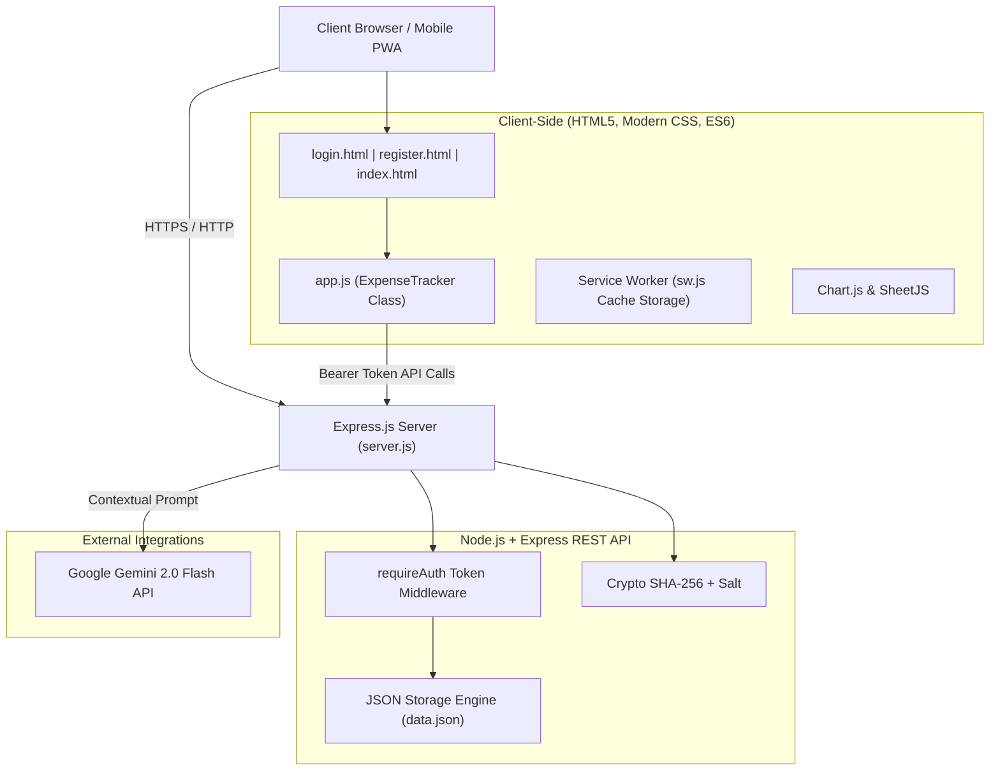

# 💰 HostelBuddy — Smart Expense & Debt Tracker for Hostlers

[](https://nodejs.org/)
[](https://expressjs.com/)
[](https://developer.mozilla.org/en-US/docs/Web/JavaScript)
[](https://web.dev/progressive-web-apps/)
[](https://ai.google.dev/)
[](LICENSE)

> A full-stack, responsive Progressive Web Application (PWA) tailored for university students and hostel residents to effortlessly manage budgets, track daily spending, split shared bills, settle debts, and consult an AI financial advisor powered by Google Gemini.

---

## 🌟 Key Features

### 🔐 Secure Authentication & Session Guards
- **Dedicated Auth Pages**: Custom-styled `/login.html` and `/register.html` interfaces featuring dynamic split layouts and interactive password strength meters.
- **Security**: Salted SHA-256 cryptographic password hashing with bearer token session tracking.
- **Route Protection**: Client-side route guards redirect unauthenticated users to login and protect private dashboard data.

### 💸 Comprehensive Expense Management
- **Full CRUD Workflow**: Fast creation, editing, and deletion of categorized expenses (Food, Transport, Utilities, Entertainment, Shopping, Health, Other).
- **Search & Filters**: Instant multi-criteria filtering by category and live keyword search.
- **Data Export**: Export expenses directly to `.xlsx` Excel spreadsheets with a single click using **SheetJS**.

### 🎯 Proactive Budgeting & Alert System
- **Real-Time Visual Ring**: SVG-based animated circular budget ring indicating percentage spent vs. remaining.
- **Overspending Detection**: Dynamic budget indicators that flag deficits (**-₹X** in bold red) and trigger notification badge alerts.
- **Granular Allocations**: Configure custom monthly limits overall and per spending category.

### 🤝 Peer-to-Peer Debt Tracking & Auto-Splitting
- **Automated Expense Splitting**: Checkbox in the expense form automatically computes split shares and generates peer debt entries.
- **Two-Way Ledger**: Separate tracking for **"I Owe"** vs. **"Owed to Me"** balances with quick-settle functionality.

### 🤖 BuddyBot — Contextual AI Financial Assistant
- **Gemini 2.0 Flash Integration**: Full-stack conversational AI powered by Google Gemini (`/api/chat`).
- **Context-Aware Insights**: Feeds current month spending, active debts, category distribution, and daily burn rates directly into prompt context for actionable financial advice.
- **Zero-Dependency Fallback**: Built-in deterministic pattern-matching fallback ensures the chatbot remains useful even without an external API key.

### 📱 Progressive Web App (PWA) & Offline Resilience
- **Service Worker (`sw.js`)**: Caches static assets, app shell, stylesheets, and icons for offline availability and snappy page loads.
- **Installable**: Full Web App Manifest (`manifest.json`) supporting desktop and mobile home screen installation.

---

## 🏗️ System Architecture



---

## 🛠️ Tech Stack

| Layer | Technologies |
|---|---|
| **Frontend** | Vanilla JavaScript (ES6+ Object-Oriented Architecture), HTML5, Custom Responsive CSS3 (Glassmorphism, CSS Variables, Flexbox/Grid) |
| **Libraries** | [Chart.js](https://www.chartjs.org/) (Doughnut, Bar, Trend Visualizations), [SheetJS / xlsx](https://sheetjs.com/) (Excel Export) |
| **Backend** | [Node.js](https://nodejs.org/), [Express.js](https://expressjs.com/) RESTful API |
| **Security & Auth** | Node.js `crypto` (Salted SHA-256), Bearer Token Sessions, CORS |
| **AI / LLM** | Google Gemini 2.0 Flash REST API |
| **Storage** | Atomic JSON Document Storage (Zero native C-compiler requirements for easy cloud deployment) |
| **PWA & Offline** | Service Worker API (`sw.js`), Web App Manifest (`manifest.json`) |
| **Deployment** | [Render](https://render.com/) ready via `render.yaml`, Windows 1-click launcher (`start.bat`) |

---

## 📂 Project Structure

```
hostler-expense-tracker/
├── .env                          # Environment variables (GEMINI_API_KEY, PORT)
├── .gitignore                    # Git ignore file (excludes secrets & dependencies)
├── index.html                    # Authenticated dashboard & application shell
├── login.html                    # Dedicated Sign-In page
├── register.html                 # Dedicated User Registration page
├── app.js                        # Frontend controller (state, charts, DOM, API calls)
├── server.js                     # Express.js REST API server & session manager
├── styles.css                    # Unified design system & responsive styling
├── sw.js                         # Service Worker for PWA caching & offline support
├── manifest.json                 # Web App Manifest for mobile/desktop install
├── data.json                     # Persistent JSON database (users, expenses, debts)
├── package.json                  # Node.js project manifest & dependencies
├── render.yaml                   # Infrastructure-as-code for Render cloud hosting
├── start.bat                     # One-click Windows development launcher
├── activity_diagram.html         # UML Activity Diagram (SVG)
├── sequence_diagram.html         # UML Sequence Diagram (SVG)
└── use_case_diagram.html         # UML Use Case Diagram (SVG)
```

---

## 📡 REST API Reference

| Method | Endpoint | Auth Required | Description |
|---|---|:---:|---|
| `POST` | `/api/register` | No | Creates a new user account with hashed password |
| `POST` | `/api/login` | No | Authenticates user and returns session token |
| `POST` | `/api/logout` | **Yes** | Invalidate active session token |
| `GET` | `/api/expenses` | **Yes** | Fetches all expenses for the authenticated user |
| `POST` | `/api/expenses` | **Yes** | Creates a new expense entry |
| `PUT` | `/api/expenses/:id` | **Yes** | Updates an existing expense |
| `DELETE` | `/api/expenses/:id` | **Yes** | Deletes an expense |
| `GET` | `/api/budget` | **Yes** | Retrieves current monthly & category budget limits |
| `PUT` | `/api/budget` | **Yes** | Updates budget limits |
| `GET` | `/api/debts` | **Yes** | Fetches all debt entries (I Owe / Owed to Me) |
| `POST` | `/api/debts` | **Yes** | Creates a new debt record |
| `PUT` | `/api/debts/:id` | **Yes** | Updates or settles a debt entry |
| `DELETE` | `/api/debts/:id` | **Yes** | Deletes a debt record |
| `POST` | `/api/chat` | **Yes** | Sends contextual data to Google Gemini AI for smart advice |

---

## 🚀 Quickstart Guide

### Prerequisites
- [Node.js](https://nodejs.org/) (version 18.0.0 or higher)
- NPM (comes bundled with Node.js)

### 1. Clone & Install
```bash
git clone https://github.com/vinod-06-ranger/Expense-tracker.git
cd Expense-tracker
npm install
```

### 2. Environment Configuration
Create or configure `.env` in the project root:
```env
PORT=3000
PASSWORD_SALT=your_custom_secret_salt_here
GEMINI_API_KEY=your_gemini_api_key_here
```
*(Note: If no Gemini key is provided, BuddyBot will automatically fall back to its internal rule-based heuristic assistant).*

### 3. Run Locally

**Option A — Windows One-Click Launcher:**
Double-click `start.bat` or run:
```cmd
start.bat
```

**Option B — Terminal:**
```bash
npm start
```
Then visit **`http://localhost:3000`** in your browser.

---

## 📄 Software Design & UML Diagrams

Interactive SVG diagrams are included in the repository:
- **Use Case Diagram**: Open [`use_case_diagram.html`](use_case_diagram.html) in any browser.
- **Activity Diagram**: Open [`activity_diagram.html`](activity_diagram.html) to see the transaction flow.
- **Sequence Diagram**: Open [`sequence_diagram.html`](sequence_diagram.html) to view auth and API communication lifecycles.

---

## 💼 Resume Ready Highlights

If you are showcasing this project on your resume or portfolio, here are recommended bullet points:

- **Full-Stack Engineering**: *Architected a full-stack Progressive Web Application (PWA) using Node.js, Express, and Vanilla ES6+ JavaScript, supporting automated shared-expense calculations and real-time category budgeting.*
- **Security & Route Protection**: *Implemented client-side SPA navigation guards alongside backend authentication featuring salted SHA-256 password hashing and bearer token session verification.*
- **Generative AI Integration**: *Integrated Google Gemini 2.0 Flash API to deliver a context-aware financial chatbot ("BuddyBot") analyzing real-time user spend patterns, burn rates, and debt liabilities.*
- **Data Portability & Visualizations**: *Built multi-metric financial dashboards using Chart.js (doughnut & trend charts) and enabled client-side spreadsheet export with SheetJS.*
- **Offline Reliability & Performance**: *Configured Service Worker cache-first strategies and PWA manifests, ensuring instantaneous page loads and offline fallback capability.*

---

## 📜 License
Distributed under the MIT License. See `LICENSE` for more information.
